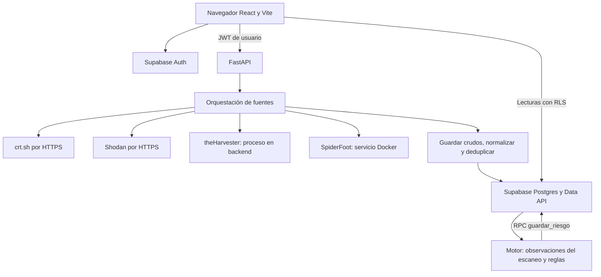

# BaxterSec: funcionamiento y revisión del Risk Score

> Este diagnóstico conserva la evidencia del 18 de noviembre. Desde el cambio
> del 20 de noviembre Censys sustituye a Shodan para escaneos nuevos y el motor
> local es 1.1.1. El catálogo Censys ya fue registrado en Supabase. Consulta las
> [instrucciones actuales](02-ejecutar-proyecto.md) y la
> [guía Censys](../backend/censys.md); los datos históricos descritos abajo no se recalcularon.

Revisión del 18 de noviembre de 2026. Describe el checkout local, la imagen Docker
existente y las consultas de lectura realizadas a Supabase. No se modificaron
colectores, motor, interfaz, reglas, migraciones ni credenciales. Tampoco se
lanzaron nuevos escaneos ni recálculos que escriban en la base.

Documentos complementarios: [ejecución](02-ejecutar-proyecto.md) y
[pruebas](03-probar-funciones.md).

## 1. Resultado de la revisión

El cero reciente no nace de un valor fijo en la gráfica: está guardado en
`puntajes_riesgo`. Tres análisis recientes revisados contienen 18, 18 y 16
observaciones. Solo son dominios, subdominios, IPs y relaciones DNS. No contienen
servicios expuestos ni CVE puntuables. El motor 1.1.0, ejecutado en memoria sobre
esas observaciones y las reglas actuales, también devuelve 0 y ningún hallazgo.
Esta simulación no llama a `guardar_riesgo` ni altera los puntajes históricos.

Reglas efectivamente leídas de la base conectada:

| Regla | Peso | Activa | Qué puede aportar |
|---|---:|---|---|
| INFRA-001 | 15 | Sí | Servicios TCP de administración remota |
| INFRA-002 | 30 | Sí | Servicios TCP de bases de datos |
| INFRA-003 | 8 | Sí | CVE asociadas a un servicio y no explícitamente descartadas por la fuente |
| IDEN-003 | 0 | Sí | Correos corporativos públicos: hallazgos informativos |
| CONF-001 / CONF-002 | 0 | No | Certificados históricos de CT |
| Otras 13 reglas | Varios | No | No aportan actualmente |

La base tiene **19 reglas, cuatro activas**. La migración local de calibración
describe un catálogo anterior de 16 reglas y seis evaluadores: no representa
por sí sola la configuración actual del servidor remoto.

Configuración observada dentro del contenedor:

```text
VERSION_MOTOR=1.1.0
SPIDERFOOT_MODULES=sfp_dnsresolve,sfp_dnsraw,sfp_robtex,sfp_crobat_api
THEHARVESTER_SOURCES=crtsh
```

Los módulos configurados de SpiderFoot se concentran en descubrimiento DNS; no
equivalen a una evaluación de puertos, CVE o seguridad de la aplicación. Un
dominio o una IP descubiertos no activan automáticamente una regla de riesgo.

En los tres análisis revisados SpiderFoot produjo las observaciones; crt.sh y
theHarvester registraron cero. En el más reciente, además, figuran incidencias de
HTTP 404 en crt.sh y rate limiting de certspotter dentro de theHarvester, aunque
sus filas estén marcadas `completado`. Por tanto, «tres fuentes completadas» no
demuestra que tres fuentes hayan aportado evidencia utilizable sin incidencias.

## 2. Diferencias entre código, contenedor y datos

| Capa | Observación |
|---|---|
| Código local y contenedor existente | Motor 1.1.0; cuatro colectores en `SOURCE_NAMES` |
| Puntajes recientes en Supabase | Versiones 1.3.0, 1.3.1 y 1.3.2 |
| Catálogo remoto de fuentes | Shodan, SpiderFoot, theHarvester, crt.sh y Web |
| Algunos análisis recientes | Solo tres registros de fuente; no aparece Shodan |
| Cobertura de algunos puntajes | Incluye estructuras y reglas ausentes del motor local |

Los datos fueron generados o recalculados por otra revisión del sistema. La
lectura no permite determinar desde qué máquina o despliegue. No se debe
reconstruir ni recalcular indiscriminadamente para «alinear» las versiones: el
motor local podría reemplazar resultados calculados con lógica más reciente.

También existen estados inconsistentes: un análisis `incompleto` tiene
`es_parcial=false`; otro `completado` tiene `es_parcial=true` y lista de fuentes
faltantes vacía. Son evidencias de la necesidad de revisar la procedencia y
semántica de esos registros antes de cambiar el código.

En el historial de la organización del análisis más reciente se leyeron 34
escaneos y 30 puntajes: 26 ceros, dos de 12, uno de 41 y uno de 60. Los cuatro
puntajes positivos pertenecen a versiones anteriores u otras revisiones del
motor; no prueban que el análisis más reciente deba tener ese mismo valor.
El gráfico completo del cliente debería poder recibir estos valores cuando
los análisis tienen fecha de fin y no quedan fuera del filtro de fechas.
No se probó visualmente la pantalla autenticada: no se dispuso de una sesión
de usuario para el navegador. Se comprobó HTTP del frontend y se siguió su
transformación de datos en el código.

## 3. Arquitectura y circulación de los datos



El frontend lee resultados directamente mediante Supabase, con la sesión del
usuario y RLS. Las acciones de crear, ejecutar y detener pasan por FastAPI.
El backend usa una llave privilegiada; por eso comprueba organización, usuario,
rol, vigencia y alcance antes de operar.

## 4. Frontend: módulos y pantallas

| Ruta o módulo | Función |
|---|---|
| `frontend/src/main.tsx`, `App.tsx` | Entrada React y montaje de la aplicación |
| `routes/AppRoutes.tsx` | Rutas reales y proveedores globales |
| `routes/RequireAuth.tsx` | Guardia de sesión, perfil y acceso de plataforma |
| `controllers/AuthProvider.tsx` | Escucha Auth, valida usuario, carga perfil y membresía de plataforma |
| `controllers/ThemeProvider.tsx`, `services/themePreference.ts` | Tema visual y preferencia local |
| `services/supabase.ts` | Cliente de navegador con URL y llave publicable Vite |
| `pages/login/` | Inicio de sesión y recuperación/restablecimiento de contraseña |
| `/admin` | Clientes, cuentas sin cliente, catálogo de reglas y fuentes |
| `/admin/clientes/:id` | Ficha del cliente, cuentas y operaciones administrativas |
| `pages/admin/adminData.ts` | Consultas y RPC administrativas, con verificaciones en base |
| `pages/dashboard/ClientPortalPage.tsx` | Portal real y coordinación de consultas/acciones |
| `dashboard/services/clientData.ts` | Consulta organización, escaneos, activos, autorizaciones, riesgo, hallazgos y fuentes |
| `dashboard/services/scanActions.ts` | HTTP a FastAPI con `access_token` |
| `dashboard/services/liveAdapters.ts` | Convierte filas reales a modelos de las pantallas |
| `/home` | Resumen, score del último análisis terminado y evolución histórica |
| `/home/activos` | Inventario, filtros y detalles de activos |
| `/home/hallazgos` | Hallazgos históricos del cliente y su evidencia |
| `/home/relaciones` | Relaciones derivadas de las observaciones del último análisis terminado |
| `/home/fuentes` | Estado, contadores, descartes y acceso al resultado crudo |
| `/home/historial` | Análisis y puntajes guardados |
| `/home/asistente` | Explicaciones almacenadas; no hay chat interactivo conectado |
| `/home/configuracion` | Cuenta, autorizaciones y apariencia |
| `dashboard/components/ScanProgressPanel.tsx` | Seguimiento de fuentes y cancelación |
| `dashboard/screens/**/components`, `controller` | Presentación, selección, filtros y diálogos por sección |
| `dashboard/services/exportOverview.ts` | Exportación del resumen |
| Archivos CSS y SVG | Apariencia, distribución, marca e iconos; no calculan el riesgo |
| Archivos `*Mock.ts`, `demoData.ts`, antigua `DashboardPage.tsx` | Maqueta conservada, no es la ruta principal |

`RiskScoreCard.tsx` conserva una tarjeta ilustrativa, pero la tarjeta activa de
`/home` está construida dentro de `ClientPortalPage.tsx`. Modificar el componente
de maqueta no arreglaría el portal real.

### Selección de puntajes y gráfica

1. `clientData.ts` trae hasta 50 escaneos, ordenados por fecha de finalización.
2. Selecciona el primer escaneo con `finalizado_en` para el resumen.
3. Consulta `puntajes_riesgo` para los IDs de esos escaneos.
4. `riskFor()` cruza por `escaneo_id`. Si no hay fila, muestra `—`, no un cero
   calculado artificialmente; el anillo vacío sí usa 0 para su fondo.
5. `liveHistoryScans()` conserva análisis finalizados con puntaje y los ordena
   cronológicamente. Usa directamente `puntaje_global`.
6. `RiskTrendChart` recibe `actualScans` y posiciona cada score en escala 0–100.
   El modo real es independiente de las series ilustrativas del mock.
7. El filtro Desde/Hasta se aplica a la fecha local del navegador. Puede ocultar
   los puntajes históricos positivos.

El inventario y los hallazgos históricos pueden crecer aunque el score del
último escaneo sea 0: son universos distintos. La lectura de activos y hallazgos
se limita a 100 filas por lista; el conteo total se consulta aparte. El portal
no muestra automáticamente todos los registros de una base grande.

## 5. Backend: módulos y responsabilidades

| Módulo | Función |
|---|---|
| `app/main.py` | FastAPI, modelos HTTP, sesión, roles, alcance, invitaciones y endpoints |
| `app/settings.py` | `.env` OSINT/Supabase, tiempos y caché de configuración |
| `app/scan_service.py` | Estados, reclamo atómico, persistencia por fuente, auditoría y cancelación |
| `app/orchestrators.py` | Colectores aislados, errores, reintentos, timeouts y subprocesos |
| `app/osint_normalization.py` | Canonización, adaptación, validación de alcance y deduplicación local |
| `app/ingestion.py` | Hash del crudo, upsert y RPC por lotes para observaciones |
| `app/risk/modelos.py` | Modelos internos: observación, regla, candidato, hallazgo y puntaje |
| `app/risk/reglas.py` | Evaluadores de los seis códigos implementados localmente |
| `app/risk/motor.py` | Confianza, aportes, combinación y cobertura; función sin escrituras |
| `app/risk/persistencia.py` | Lee observaciones/reglas y llama a `guardar_riesgo` |
| `app/api/router.py`, `api/routes/health.py` | Rutas heredadas de salud bajo `/api/v1` |
| `app/core/config.py`, `db/session.py`, `services/health.py`, `schemas/health.py` | Conexión PostgreSQL directa opcional para salud |
| `pyproject.toml` | Paquete, dependencias Python y configuración de pytest |
| `mock_data.json`, `tests/` | Datos de muestra y pruebas; no equivalen a consultas reales |

Hay dos configuraciones: `app/settings.py` para el flujo de Supabase/OSINT y
`app/core/config.py` para la salud PostgreSQL directa. `/api/v1/health/db` puede
fallar por no tener `BAXTERSEC_DATABASE_URL` aunque las consultas REST a Supabase
funcionen.

### Contrato de acciones

| Método y ruta | Acción |
|---|---|
| GET `/health` y `/api/v1/health` | Disponibilidad del proceso |
| GET `/api/v1/health/db` | PostgreSQL directo opcional |
| POST `/api/admin/clientes/{id}/usuarios/invitar` | Invitación y asignación; requiere admin de plataforma |
| POST `/api/escaneos` | Crea pendiente con autorización vigente |
| GET `/api/escaneos` | Lista de la organización |
| POST `/api/escaneos/{id}/ejecutar` | Reclama e inicia; responde 202 |
| POST `/api/escaneos/{id}/detener` | Cancela según usuario/rol |
| GET `/api/escaneos/{id}` y `/fuentes` | Estado y avance |
| GET `/api/escaneos/{id}/hallazgos` y `/riesgo` | Resultados persistidos |
| POST `/api/escaneos/{id}/riesgo/recalcular` | Escribe riesgo desde observaciones existentes |

Los colectores corren concurrentemente. Cada resultado termina en persistencia
sin esperar a la fuente más lenta. Una fuente que falla no cancela las demás.
Los estados locales son pendiente, ejecutando, completado, incompleto, fallido
y cancelado. Para cuatro colectores, solo cuatro éxitos dan `completado`.
Los trabajos y controles de cancelación viven en memoria de un proceso; no hay
cola durable. El arranque puede cerrar escaneos antiguos atascados. La
cancelación conserva resultados ya guardados y trata de detener procesos y el
escaneo remoto de SpiderFoot.

### Qué hace cada fuente

- crt.sh: consulta Certificate Transparency, valida lista JSON y reintenta
  errores transitorios. Un certificado histórico no confirma el TLS servido hoy.
- Shodan: resuelve dominio por su API y consulta hosts por IP; depende de permisos
  de la cuenta. Un 403 no implica que Supabase esté desconectado.
- theHarvester: ejecutable externo con dominio y fuentes; genera reporte temporal
  JSON/JSONL. El código revisa también estados de proveedores en reportes JSONL.
- SpiderFoot: inicia por HTTP con lista explícita de módulos, consulta progreso
  y exporta JSON; intenta detener el escaneo si se cancela la tarea.

## 6. Normalización, base y motor

La normalización transforma nombres a minúsculas/IDNA, normaliza IPs, correos,
fechas y valores `IP:puerto/protocolo`. Filtra nombres/correos fuera de alcance,
interpreta eventos compatibles y cuenta descartes. No convierte todos los cientos
de eventos posibles de SpiderFoot en evidencia evaluable.

La ingesta guarda el crudo con hash canónico, evita duplicados por escaneo/fuente/
hash y procesa lotes con `ingestar_observaciones`. La base conserva el inventario
deduplicado y la evidencia de cada escaneo. Un activo previamente conocido puede
generar una observación nueva sin crear otro activo.

| Tabla | Función |
|---|---|
| `usuarios`, `organizaciones` | Identidad, perfil, organización y estado |
| `administradores_plataforma` | Membresía administrativa global, distinta de `usuarios.rol=admin` |
| `autorizaciones_dominio` | Alcance, vigencia y evidencia de autorización |
| `escaneos` | Ciclo de vida y solicitante |
| `fuentes_osint`, `resultados_fuentes` | Catálogo y resultado de cada colector |
| `resultados_crudos` | JSON original, hash y estado de ingesta |
| `activos`, `observaciones` | Inventario y hechos normalizados |
| `reglas_riesgo` | Catálogo, pesos, severidades y activación |
| `hallazgos` | Coincidencias por activo, regla y escaneo |
| `puntajes_riesgo` | Categorías, global, cobertura, parcialidad y versión |
| `bitacora_auditoria` | Acciones y errores de operación |
| `explicaciones_ia` | Explicaciones almacenadas |

Las migraciones locales recorren: esquema base; Auth/RLS; fuentes; ingesta;
motor de riesgo; inicio atómico; protección de creación de organización;
administración de plataforma; asignación de usuarios; gestión de clientes y
reglas; edición transaccional de reglas por lote; cancelación; calibración.
`seed.sql` carga el catálogo inicial. `baxtersec_schema.sql` es una referencia;
no debe aplicarse encima de una base migrada como si fuese una migración nueva.
No se auditó exhaustivamente cada política RLS ni se comparó el historial remoto
de migraciones en esta revisión.

El motor local evalúa solo las observaciones del escaneo seleccionado:

```text
aporte = peso × (0.6 + 0.4 × confianza)
confianza = mínimo(0.99, confianza_base + 0.15 × (fuentes_independientes - 1))
categoría = 100 × (1 - producto(1 - aporte / 100))
global = misma combinación de las categorías ya redondeadas
```

Las categorías son infraestructura, identidad digital, configuración y fuga de
datos. Las reglas inactivas, sin evaluador o sin fuentes disponibles se reportan
en cobertura. `INFRA-003` requiere un activo `servicio`, un identificador CVE válido
y `verificado` distinto de `False`; ausencia de esa marca tampoco confirma
verificación técnica. No se prueba explotabilidad. La cobertura indica ejecución
de evaluadores, no una auditoría completa de seguridad.

`guardar_riesgo` persiste hallazgos y puntaje transaccionalmente; el diseño local
conserva el estado analítico en recálculos. Las versiones remotas pueden tener
semántica adicional. Un recálculo no vuelve a consultar OSINT y sí escribe datos.

## 7. Docker y despliegue

`compose.yaml` crea backend y SpiderFoot; Supabase es externo y el frontend se
ejecuta aparte. El backend incluye theHarvester en `/opt/theHarvester`; SpiderFoot
se alcanza por `http://spiderfoot:5001`, no por el localhost del contenedor.
Los puertos 8000 y 5001 se publican solo en loopback. El volumen
`spiderfoot-data` conserva sus datos. Los Dockerfiles fijan commits de las
herramientas, pero el backend y SpiderFoot no tienen todas las dependencias
transitivas bloqueadas. Los cambios de archivos locales no entran en una imagen
ya construida porque Compose no monta el código como volumen.

Vercel sirve el frontend. La API pública necesita su propio alojamiento, HTTPS
y CORS correcto; `localhost:8000` de un navegador remoto no es el servidor.
`frontend/vercel.json` estaba vacío en este checkout: verificar navegación SPA
por enlaces directos antes de dar por validado el despliegue.

## 8. Qué se comprobó y qué queda pendiente

- Docker Desktop iniciado; backend y SpiderFoot existentes saludables.
- `/health` respondió; SpiderFoot devolvió HTTP 200 desde backend.
- Frontend Vite iniciado en 127.0.0.1:5173 y HTML accesible por HTTP.
- Acceso a `/api/escaneos` sin sesión y con `Bearer 1`: HTTP 401.
- Supabase accesible con el cliente del contenedor; lectura de reglas, fuentes,
  escaneos, observaciones y puntajes confirmada.
- 85 pruebas de riesgo, colectores, configuración, normalización, ingesta y ciclo
  de vida pasaron; lint y tipos de ambos proyectos TS del frontend pasaron.
- La suite completa local no pudo recolectarse: faltan `pydantic_settings` y
  `sqlalchemy` en el entorno local. No se instalaron ni cambiaron dependencias.
- No se accedió al dashboard con usuario real ni se verificó visualmente la gráfica.
- No se lanzaron consultas OSINT nuevas, escaneos, cambios de reglas o recálculos
  persistentes. Los estados de proveedores corresponden a resultados guardados.

## 9. Orden propuesto para una corrección futura, aún no aplicada

1. Identificar el código que generó 1.3.2 y comparar despliegue, branch y esquema.
2. Decidir cuál es la versión válida antes de reconstruir o recalcular.
3. Alinear fuentes previstas, ejecutadas y faltantes, incluyendo `Web`/Shodan.
4. Revisar estados `completado` que conservan errores y contradicciones de parcialidad.
5. Elegir evidencia nueva que se quiera medir y cómo verificarla; no aumentar pesos
   solo para lograr un número distinto de cero.
6. Probar con fixtures sintéticos puntuables y luego con un objetivo de desarrollo
   expresamente autorizado; separar inventario, cobertura y seguridad.
7. Comprobar la gráfica autenticada, limpiando filtros y comparando UUID/score con
   la fila de Supabase. Los positivos históricos no deben mezclarse sin contexto
   de versión con el motor actual.

Referencia usada para el diagnóstico de Supabase:
[Observability](https://supabase.com/docs/guides/observability).
